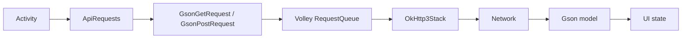

# Android Networking I: OkHttp, Volley and Gson


A Java Android sample showing how to combine Volley, OkHttp, and Gson in one
small networking playground.

The app uses Volley as the request queue and UI-facing request API, swaps in a
custom OkHttp-backed `HttpStack` as the transport layer, and parses JSON
responses with reusable Gson request classes.

## What It Demonstrates

- A Volley `RequestQueue` backed by `OkHttp3Stack`.
- Generic `GsonGetRequest<T>` and `GsonPostRequest<T>` implementations.
- Gson parsing for a JSON object and a JSON array.
- A custom Gson deserializer for the sample `DummyObject` model.
- Request tagging and cancellation from `onStop()`.
- Volley `ImageRequest` for a single remote bitmap.
- Volley `NetworkImageView` with a shared `ImageLoader`.
- An `LruBitmapCache` sized from the device display.
- Data Binding for simple click handlers and screen bindings.

## Demo Screens

| Screen | What It Shows |
| --- | --- |
| `JsonObjectActivity` | GET a single object and bind title/body text. |
| `JsonArrayActivity` | GET an array and render multiple parsed objects. |
| `NetworkImageViewActivity` | Load a list of remote images through Volley image loading. |
| `ImageRequestActivity` | Load one bitmap through `ImageRequest` with an error fallback. |

## Request Flow



## Project Shape

| Area | Files |
| --- | --- |
| App/request queue | `App.java` |
| Request definitions | `ApiRequests.java` |
| Gson requests | `GsonGetRequest.java`, `GsonPostRequest.java` |
| OkHttp bridge | `OkHttp3Stack.java` |
| Models | `DummyObject.java`, `DummyObjectDeserializer.java` |
| Image loading | `LruBitmapCache.java`, `NetworkImageViewActivity.java`, `ImageRequestActivity.java` |
| UI launcher | `MainActivity.java` |

## Tech Stack

- Java
- Android Gradle Plugin 3.0.1
- Gradle 4.5.1
- compile SDK 27, target SDK 27, min SDK 16
- Android Support Library 27.0.2
- Volley 1.0.0
- OkHttp 3.9.1
- Gson 2.8.2
- Data Binding
- RecyclerView and ConstraintLayout

## Run It

This repo is pinned to 2018 Android tooling. For the least friction, use an
Android Studio/JDK setup compatible with AGP 3.0.1 and Gradle 4.5.1.

```bash
./gradlew :app:assembleLiveDebug
./gradlew :app:installLiveDebug
```

The sample uses old public demo endpoints and image URLs. If any network call no
longer responds, the app still remains useful as a reference for the request,
transport, parsing, caching, and cancellation patterns.

## Status

This is a historical sample for an old Android networking article series, not a
modern networking template. Its value today is as a compact reference for how
Volley, OkHttp, and Gson can be wired together in a pre-AndroidX Java app.

## License

The original README declared this repository to be MIT licensed. A standalone
`LICENSE` file is not currently present in the repository.
